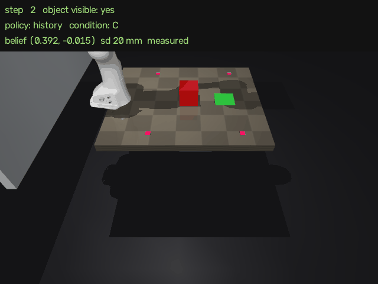
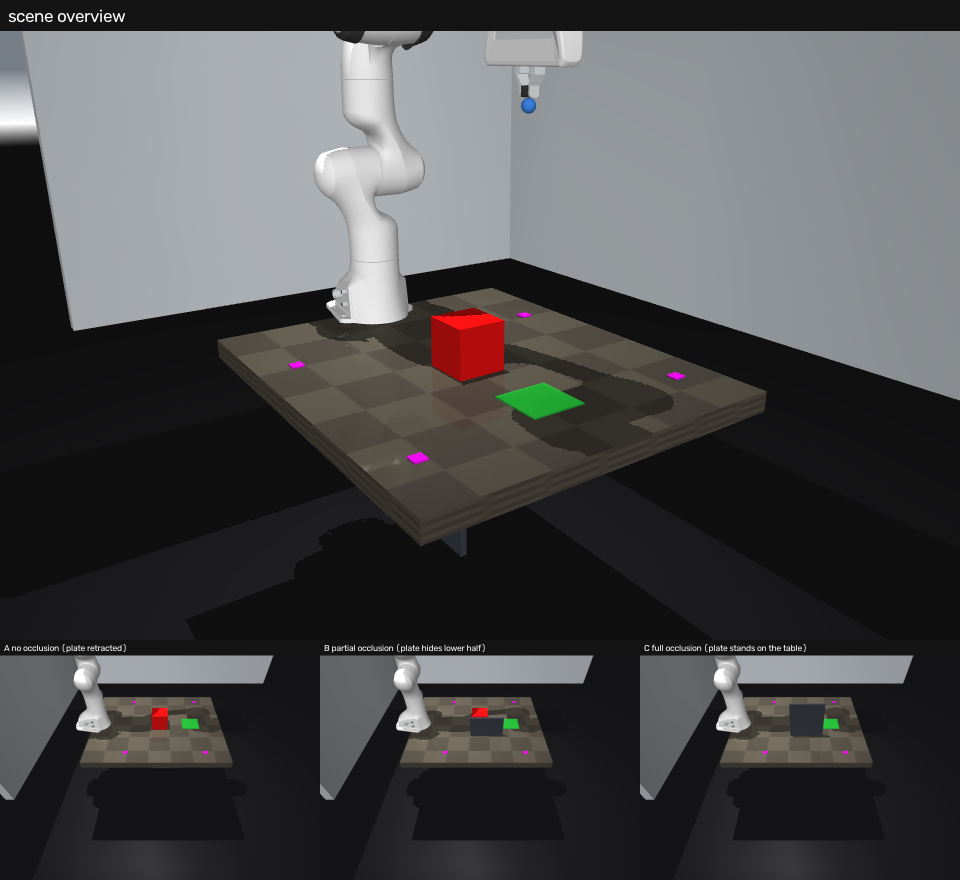
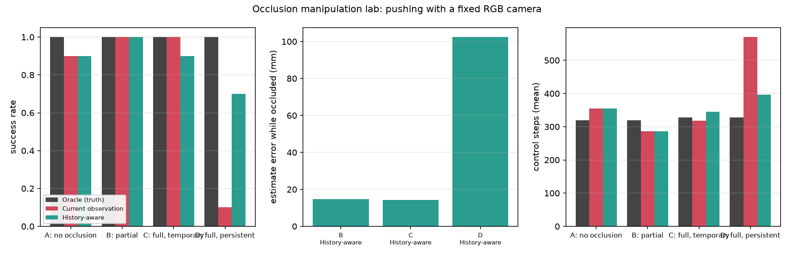

# MuJoCo Occlusion Manipulation Lab

MuJoCo · Franka Panda · OpenCV · Python 3.12

固定 RGB 相机下的机械臂推箱实验台：把红色方块推到绿色目标区，比较**只用当前帧**与**带历史状态估计**两种策略在四种遮挡条件下的表现。

目的是把「观察 → 估计 → 规划 → 执行 → 反馈 → 更新」这条闭环完整跑起来，并在物体从画面里消失时继续维持它。



*C 档：挡板在第 189 步升起，方块从画面中消失 100 个控制步，机器人依据状态估计继续推动；方块重新可见后 1 步完成重定位。叠加文字实时显示策略名、遮挡条件与估计位置。*

## 场景与任务

| 项目 | 内容 |
| --- | --- |
| 机械臂 | Franka Panda，7 自由度，末端 6 维阻尼最小二乘逆解，500 Hz |
| 任务 | 把 10 cm 红色方块从随机初始位置推到绿色目标区，容差 50 mm |
| 传感器 | 一台固定 RGB 相机（640×480，世界坐标系，第三人称） |
| 遮挡 | 双滑轨挡板，22 cm 高，`contype=conaffinity=0`——只挡相机视线，不改变机械臂可达性 |
| 成功判定 | 方块中心与目标点距离 < 50 mm |
| 控制 | 50 Hz 指令，每指令 10 个子步 |

方块初始位置由种子决定，同一批种子在各策略间配对，保证起点一致。

## 方法

三个模块串成闭环，策略只消费最后一个模块的输出：

**视觉定位**　四个洋红标定块的桌面坐标已知，一次性拟合单应矩阵；红块由 HSV 阈值分割，质心经单应映射到桌面坐标。遮挡判定来自红色像素面积占比（可见 / 部分遮挡 / 完全遮挡）。方块是 10 cm 立方体，斜视下轮廓质心不等于底面中心，这个偏差作为常量在标定阶段一次拟合。

**状态估计**　可见时用测量值校正；不可见时用「推球接触 → 跟随工具速度、否则速度衰减」的模型外推；不确定性随隐藏时间增长，超过阈值判为丢失并触发后退重观测。三个状态（`measured` / `predicted` / `lost`）都有单元测试。

**推动控制**　`GO_ABOVE → DESCEND → ADVANCE` 三阶段推挤，末端沿「物体 → 目标」方向逼近，偏离推动线超过阈值时重规划。

| 策略 | 物体位置来源 | 物体不可见时 |
| --- | --- | --- |
| `oracle` | MuJoCo 真值 | 继续推动（仅作上界与调试） |
| `current-obs` | 当前帧检测 | **停止并等待**，不使用历史位置 |
| `history` | 状态估计 | 按预测继续推动，重新可见后校正 |

只有 `oracle` 会读 `object_truth_xy()`；另两个策略只拿到 `obs["detection"]`（像素 → 桌面坐标），真值不进入控制回路。

## 遮挡条件

| 代号 | 设置 |
| --- | --- |
| A | 无遮挡 |
| B | 挡板停在半高，方块始终部分可见 |
| C | 推球首次接触方块的当步挡板升起，横向跟随方块，保持 100 个控制步（2 s）后落下 |
| D | 同 C，但挡板不再落下——物体在剩余回合内始终不可见 |



*上：场景全景（洋红为标定块，绿色为目标区）。下：A / B / C 三种遮挡程度下的相机视图。*

## 结果

每格 10 个配对种子，共 120 集。

| 条件 | oracle | current-obs | history |
| --- | --- | --- | --- |
| A 无遮挡 | **10/10** (319 步) | 9/10 (355) | 9/10 (355) |
| B 部分遮挡 | **10/10** (319) | 10/10 (286) | 10/10 (287) |
| C 完全遮挡 100 步 | **10/10** (328) | 10/10 (318，等待 100) | 9/10 (344) |
| D 完全遮挡不恢复 | **10/10** (328) | 1/10 (570，等待 381) | 7/10 (396) |



遮挡期间的位置估计误差（离线用真值计算，仅用于统计，不反馈给策略）：B 档 **14.8 mm**、C 档 **14.3 mm**、D 档 **102.4 mm**。物体重新可见后，状态估计在 **1 个控制步**内恢复为测量值。

三条可以直接读出来的结论：

1. **真值上界在所有条件下都是 40/40**，说明场景与推动原语本身没有问题，差异全部来自感知。
2. **短暂遮挡不需要记忆**。C 档里 `current-obs` 靠原地等待拿到 10/10，`history` 反而多用 26 步并掉了一个种子——当物体很快返回、且机器人等得起时，缓存历史位置没有收益。
3. **持续遮挡是记忆决定成败的场合**。D 档里基准策略退化为 1/10（平均等待 381 步等一个不会回来的物体），`history` 完成 7/10。同时它的估计误差升到 102 mm：常速 + 推球耦合模型在方块打滑后就会偏离，这是该模型的作用边界。

## 复现

```bash
python3 -m venv .venv && . .venv/bin/activate
pip install -e .            # mujoco / numpy / opencv-python / imageio / matplotlib / pytest

MUJOCO_GL=egl python scripts/00_env_check.py                    # 加载场景并渲染一帧
MUJOCO_GL=egl python scripts/20_calibrate.py                    # 拟合 configs/calibration.json
MUJOCO_GL=egl python scripts/30_run_matrix.py --seeds 3 --conditions A,B,C,D
MUJOCO_GL=egl python scripts/31_plots.py --in results/matrix.json --out figures
MUJOCO_GL=egl python scripts/40_demo_video.py --condition D --policy history --seed 0
MUJOCO_GL=egl pytest -q
```

`30_run_matrix.py` 输出 `results/matrix.json`（逐回合记录）与 `results/matrix.csv`（汇总），`--render-scale` 控制检测用的渲染分辨率。无显示环境下用 EGL 渲染。

## 目录结构

```text
mujoco-occlusion-lab/
├── assets/panda/          Panda 模型（来自 mujoco_menagerie）与本项目场景
├── configs/               运行配置与标定结果
├── src/occlab/
│   ├── envs/              场景、观测、成功判定、遮挡调度
│   ├── perception/        单应标定、颜色分割与遮挡分类
│   ├── state_estimation/  物体状态估计
│   ├── planning/          推动原语与三种策略
│   └── control/           阻尼最小二乘逆解
├── scripts/               00 环境检查 / 20 标定 / 30 批量评测 / 31 绘图 / 40 演示视频
├── tests/                 29 个测试
├── docs/                  设计说明、阶段报告、简历描述
└── figures/               README 引用的图与表格
```

## 关键设计决策

**固定第三人称相机，不加腕部相机。** 遮挡因子因此完全来自场景几何，而非机械臂自遮挡。若用腕部相机，物体靠近时被自身挡住的那类问题会混进来，实验就不再是同一个问题。

**工具点用推球而不是指尖。** 指尖由网格顶点决定，边界不清晰；一个半径 12 mm 的球体刚性挂在手前，工具点由 `geom_xpos` 精确读回，推挤高度与接触位置都可复现。

**标定来自标定块，不来自仿真。** 四个标定块的桌面坐标在场景里是已知常量，单应矩阵由图像中的质心拟合，并用涂在地面上的目标区做独立校验。检测误差在工作区 30 个位置上实测，均值 13.4 mm、最大 23.1 mm。

**真值与控制回路隔离。** 视角真值只出现在 `oracle` 与离线统计里，`current-obs` 与 `history` 的接口里没有真值字段。

**挡板跟随物体移动。** 挡板只固定在桌面上时，方块移动几厘米就会从挡板边缘重新露出，"完全遮挡"实际只持续十几步；横向滑轨让遮挡在整个推挤过程中成立。

## 局限

- 单物体、单颜色，HSV 阈值分割，无深度、无学习式感知。
- 标定仅在桌面平面有效，机械臂换位或相机移动后需要重新标定。
- 状态估计是常速 + 推球耦合模型，没有物体动力学与打滑模型。
- 推动是单次脚本化推挤，没有抓取、多次推挤与失败恢复策略。
- 每格 10 个种子，单集差异（如 9/10 与 10/10）不构成显著差别。

## 致谢与许可

机械臂模型来自 [google-deepmind/mujoco_menagerie](https://github.com/google-deepmind/mujoco_menagerie) 的 `franka_emika_panda`（BSD-3-Clause），本地修改说明见 `assets/panda/README_mods.md`。其余代码、场景与实验为本项目所写。

本仓库代码以 MIT 许可发布。
